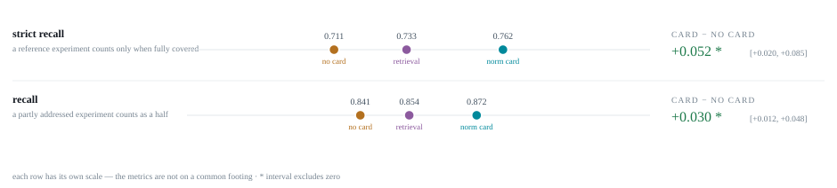

# norm-cards

Does telling an LLM **how a research field runs experiments** help it design better
experiments?

A **norm card** is a structured summary of one subfield's experimental practice —
its standard datasets, models and metrics, and more importantly its *protocols,
controls and confounds*. We build one card per subfield, hand it to an experiment
proposer along with a scientific claim, and measure whether the proposals it
designs would have recovered what the claim's source paper actually did.

**Current result** (dataset50 · 100 claims × 6 proposers · November 2026). [`datasets/dataset50`](datasets/dataset50),
built as described in [`build/README.md`](datasets/dataset50/build/README.md): 50 papers in five fields, 100 claims,
20 format-2 cards built by gpt-6-luna. Proposers get the claim and its subclaims, with Current Evidence reading "None";
the card arrives as a **Field Norms** block and the retrieved passages as a **Relevant Literature** block, each with
one system line saying what it is (`propose --prompt fieldnorms2`, the default). Budget **5** experiments (the
default; 9 before). Judge gpt-6-luna, prompt v2, three passes majority-voted. Strict recall, card − no card, paired
bootstrap over claims:

| proposer | no card | retrieval | norm card | card − no card |
|---|---:|---:|---:|---:|
| gpt-6-sol | 0.577 | 0.612 | 0.621 | +0.044 [−0.000, +0.093] |
| gpt-6.1-sol | 0.656 | 0.644 | 0.676 | +0.020 [−0.020, +0.060] |
| gpt-6.1-terra | 0.614 | 0.623 | 0.651 | +0.037 [−0.000, +0.075] |
| Qwen3.8-27B (open weights) | 0.432 | 0.464 | 0.492 | **+0.060 [+0.013, +0.108]** |
| gpt-5.6-terra | 0.602 | 0.600 | 0.631 | +0.030 [−0.011, +0.071] |
| gpt-5.6-luna | 0.616 | 0.670 | 0.672 | **+0.056 [+0.019, +0.094]** |
| **all six, pooled** | 0.583 | 0.602 | 0.624 | **+0.041 [+0.024, +0.058]** |

The card beats retrieval too, +0.022 [+0.005, +0.040] pooled, and every proposer gains. Each reference experiment
carries one type, labelled by gpt-6-luna (`build/types.json`): headline, threat (controls, confounds, measurement and
robustness checks), analysis, or setup. On threats alone the pooled gain is **+0.063 [+0.029, +0.097]** (Qwen
+0.107); on headline experiments it is +0.009. The earlier setup (first Field Norms prompt, budget 9) gave +0.022
[+0.005, +0.041] pooled over the same six proposers. Qwen reasons for about 9k tokens per proposal, so its
responses are streamed; its endpoint's gateway drops silent connections. The 34-claim sets behind the result below
were removed from the tree on 2026-10-30 and live in git history at `592db40`.

**Previous result** ([full report](docs/RESULTS.md) · 34 claims × 5 proposer models, October 2026):

| | no card | retrieval | norm card | card − no card |
|---|---|---|---|---|
| Strict recall | 0.711 | 0.733 | **0.762** | **+0.052 [+0.020, +0.084]** |
| Recall (partial counts a half) | 0.841 | 0.854 | 0.872 | **+0.030 [+0.012, +0.048]** |

Card − no card on strict recall is **+0.052**, 95% interval **[+0.020, +0.084]**, over 170 paired
claim × model comparisons, judged by `gpt-6-luna` with three passes majority-voted. Strict recall
counts a reference experiment only when the judge marks it *fully* covered; a half-addressed
experiment is not something a downstream system can run. The looser recall, which gives a
partial half credit, moves about 60% as much — the card mostly finishes work rather than adding
it. Both exclude zero.

Retrieval draws on the same field papers as the card, unformatted, so card − no card is the
comparison that tests whether norms help; card − retrieval, +0.029 [−0.004, +0.063], is what
formatting them as a card adds on top, and it does not clear zero.



Until October 2026 the judge was `gpt-5.6-terra`, which costs about nine times as much.
`gpt-6-luna` is stricter, so absolute recall is about 0.08 lower than earlier revisions
reported; on the same proposals terra found card − no card +0.044 [+0.017, +0.072].

The cards are **shared, not per-claim**: 14 cards cover all 34 claims, each built from its
field's name alone with no claim text anywhere in the loop. That matters because a card
retrieved using the claim it will be tested on proves very little.

Each claim is scored only against the reference experiments that decide it. Papers support
several claims, and scoring a proposal against experiments belonging to a *different* claim
of the same paper was holding recall near 0.55 for reasons that had nothing to do with the
proposer — see [`datasets/dataset34v5/`](datasets/dataset34v5).

---

## Quickstart

```bash
python3 -m venv .venv && ./.venv/bin/pip install -r requirements.txt
cp .env.example .env          # add OPENAI_API_KEY
```

Reproduce the dataset50 run from the tracked dataset (`datasets/dataset50/build/scripts/run_eval.sh` does
the same with sharding):

```bash
# 1. lay the dataset out into a disposable run directory
./.venv/bin/python -m norm_cards.dataset bootstrap --dataset dataset50 --run results/myrun
./.venv/bin/python -m norm_cards.dataset assemble  --dataset dataset50 --run results/myrun

export NORM_CARDS_EVAL_ROOT=results/myrun/eval
export NORM_CARDS_CLAIMS=norm_cards/data/dataset50-claims-v1.jsonl

# 2. propose — 100 claims × 3 arms × the default gpt-6 proposers
./.venv/bin/python -m norm_cards.eval.propose \
    --arms nocard,rag,card --cards results/myrun/cards --budget 9 --workers 9 \
    --out results/myrun/proposals

# 3. judge — three passes per arm; --add-passes tops up arms judged with fewer
./.venv/bin/python -m norm_cards.eval.evaluate --problems all \
    --source results/myrun/proposals --judge-runs 3 --prompt v2 --model gpt-6-luna

# 4. read the numbers, per proposer and pooled
D50_RUN=results/myrun D50_PROPOSALS=proposals \
    ./.venv/bin/python datasets/dataset50/build/scripts/report_data.py results/myrun/report.json
```

`evaluate` majority-votes the `k` judge runs per arm and parallelises across them
(`--workers`), not across problems. To shard, run it several times over disjoint
`--problems` lists in parallel; output is per problem, so they do not collide.

**No API key?** `python -m norm_cards.test_gather` exercises search and ranking
against real keyless sources.

---

## How the experiment works

Both sides come from the same paper by two routes that never meet. One route keeps
the authors' experiments; the other keeps only the question they were answering.

```
paper ─┬─ transcribe experiments ──────────────► reference experiments
       │                                              │
       └─ draft the claim                             │
          (drop the method AND the apparatus)         │
                    │                                 │
                    ▼                                 ▼
              proposer ── one of three ──►  proposed experiments ──► judge ──► recall
                          conditions                                    ▲
                                                                        │
                nocard   nothing but the claim                    blind to the
                rag      full text of the field's papers          condition; never
                card     the curated norm card                    sees the card
```

The three conditions draw on **identical source material**: the `rag` arm gets raw
BM25 passages from the same subfield papers the card was distilled from, trimmed to
the card's own character budget. So the contrast is curation, not access or context
length.

### Recall, and why the denominator is the hard part

Strict recall is the share of *reference* experiments the judge marks fully covered.
The mapping is many-to-many: one broad proposal can carry several reference items.

The denominator is the part that took the longest to get right. `transcribe` copies
**all** of a paper's experiments, but a paper usually supports several claims, so scoring
a proposal against experiments belonging to a *different* claim of the same paper asks
"would you have reproduced the paper?" — not the question, and it held recall near 0.55
for reasons that had nothing to do with the proposer.

An earlier attempt asked a model, per experiment, whether the claim *required* it, and
dropped the rest. That was abandoned: it could only keep or discard, when the right answer
is usually that the experiment belongs to another claim. The per-claim split
([`datasets/dataset34v5/`](datasets/dataset34v5)) reassigns instead, and keeps everything
the scoping labels called required — [`split_validation.md`](datasets/dataset34v5/split_validation.md)
has the comparison.

With the denominator fixed, 27% of a claim's reference is still mechanism and external
follow-up rather than work the claim obliges, so `analyze` reports the split (on graded
recall, which the role breakdown uses):

| denominator | card − no card |
|---|---|
| claim-obliged (headline + apparatus + control + confound) | +0.026 [+0.003, +0.050] |
| beyond-claim (mechanism + external) | +0.031 [+0.000, +0.064] |

**The gain is spread evenly across both.** Before the split it looked concentrated in the
beyond-claim half (+0.074 against +0.012), which was the strongest claim this harness made
and is now retracted: it was an artifact of scoring each claim against its whole paper.
The claim-obliged half separates from zero on its own; the beyond-claim half sits on the edge.

---

## Repository layout

```
datasets/dataset20v3/     tracked INPUTS — cannot be regenerated cheaply
  dataset.json              manifest: which claims, which models, review status
  references/               20 reference experiment sets, transcribed from papers
  cards/                    the 14 shared subfield cards (~2h of API time)
  subfield_bundles.jsonl    the papers each card was built from; feeds the rag arm
  subfields.json            claim → subfields, including 10 hand corrections
  subfield_overrides.json   each correction with its written rationale

norm_cards/
  dataset.py              bootstrap + assemble a dataset into a run directory
  subfield_gather.py      retrieve papers for a SUBFIELD (never using claim text)
  normcard.py             map/reduce a paper bundle into per-subfield menus
  curate.py               deterministic merge + prune; no model calls
  classifier.py           claim → subfields
  scify_proposer.py       the proposer, resynced against the real SciFy agent
  eval/
    make_claims.py        paper → claim
    transcribe.py         paper → reference experiments (gated behind --accept)
    build_cards.py        paper bundles → norm cards
    propose.py            run the arms
    evaluate.py           the blind judge
    analyze.py            arm means, paired intervals, the role split
    audit.py              reference-blind per-proposal audit, for precision
    judge_suite.py        known-answer test suite for the judge itself
    audit_suite.py        the same, for the auditor

results/                  git-ignored. Disposable: rebuildable from datasets/.
```

---

## Building a dataset from scratch

Only needed for *new* claims; `dataset20v3` is already built.

```bash
# claims and references, drafted separately so neither leaks into the other
python -m norm_cards.eval.make_claims --papers papers.json --out claims.jsonl
python -m norm_cards.eval.transcribe  --problem <id> --arxiv <arxiv id>
python -m norm_cards.eval.transcribe  --problem <id> --accept --author "Your Name"

# subfields, then one retrieval and one card per subfield serving >=2 claims
python -m norm_cards.classifier       --claims claims.jsonl --out subfields.json
python -m norm_cards.subfield_gather  --subfields subfields.json --out shared/
python -m norm_cards.eval.build_cards --run shared/ --limit 1   # repeat until done
```

`--limit 1` builds one card per process. Card construction holds the full text of
every paper it has read, and the loop was OOM-killed four times before this existed;
re-running resumes, so a kill costs one card rather than the batch.

### What a claim must and must not say

This took three drafts to get right, and both failure modes cost a full rebuild.

- **Say** the phenomenon, the subject under test, and the bar **with its number**.
- **Never say** the authors' method — that hands over the design.
- **Never say** the apparatus — which datasets, baselines, prompts, splits or
  protocol. v2 named all of these and recall looked fine, but the proposer had
  nothing left to design, so the card had nothing to inform. The test: *if a
  competent researcher could have picked a different dataset or baseline set and
  still tested the same proposition, it is apparatus — leave it out.*

Measured across the three drafts: named artifacts per claim went 1.4 → 6.7 → **0.8**
while claims carrying a decidable bar went 0 → 17 → **19**.

### Reviewing references

`transcribe` writes `ground_truth.draft.json` and refuses to promote it; `--accept
--author` does that, and the schema validator rejects anything whose provenance
still says draft. The dataset's references are currently promoted with the author
line **"PENDING HUMAN SIGN-OFF"**, which the judge is shown. Re-accept under your own
name once you have read them against the papers.

---

## Things worth knowing before you trust a number

- **The judge is `gpt-6-luna` with prompt v2, runs without tools, and is run three
  times per arm** with a majority vote per reference experiment (unanimous on 77% of items,
  no majority on 8 of 2,640). It replaced `gpt-5.6-terra` in October 2026 for cost ($5.78
  against $54 for the 510 arms); the two agree on 84.8% of items, and terra agrees with
  itself on 87.2%. v2 is short: it asks what each reference experiment
  establishes and whether the proposed set would learn the same, and sees the proposer's
  numbered subclaims, since proposals cite them by number. v1 stays in `prompts.PROMPTS`;
  `evaluate --prompt v1` reproduces older runs. The judge must never
  grade proposals written by its own model.
- **`judge_suite.py` is the judge's own test suite** — 14 behaviours x 3 unrelated domains,
  each case constructed with a known correct status per reference experiment and run
  several times. It reports target pass rate, collateral damage and self-agreement per
  `model:prompt`, so two judges can be compared directly. Terra replaced gpt-5.6-luna because
  luna credited controls run outside the setting the claim names; under the current prompt
  terra and gpt-6-luna tie at 78/84 majority-voted.
- **`propose` skips per claim, not per arm.** Adding a model in a second invocation
  against the same output directory silently skips every claim the first finished.
  Pass all models in one `--models` call, or add `--merge` to run only the missing
  models' arms and merge them into the existing files.
- **Contamination is filtered on arXiv v1 date**, never venue date.
- **No single model carries the headline.** On strict recall four of five proposers gain —
  gpt-6-sol +0.117, gpt-6.1-sol +0.065, gpt-5.5 +0.055, gpt-5.6-sol +0.047 — and gpt-5.4 is
  slightly worse with the card (−0.025). Only gpt-6-sol excludes zero on its own, +0.117
  [+0.045, +0.194]. Below that the ordering changes with the judge (under terra gpt-5.4 gained
  +0.046 and gpt-5.6-sol was flat), so treat any per-model figure as indicative. The largest
  gain belongs to the weakest unaided proposer (gpt-6-sol, 0.642 no-card), which is the
  pattern you would expect if the card supplies something a stronger model already has.
