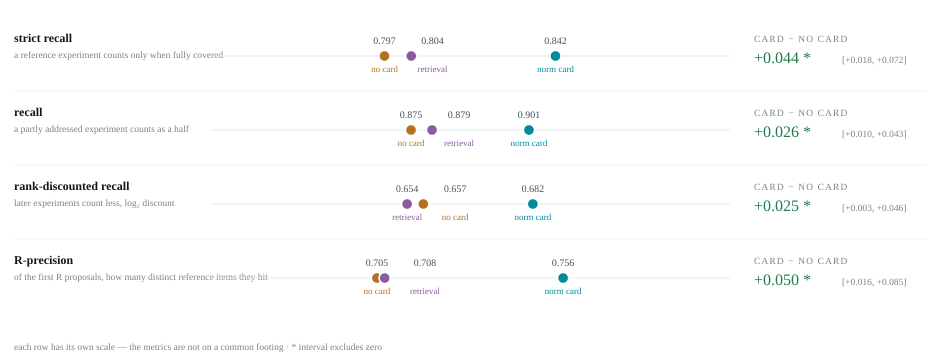
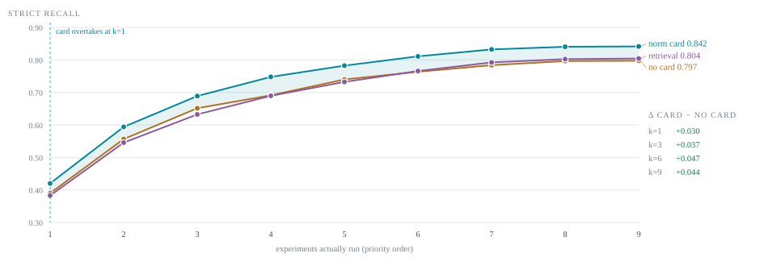
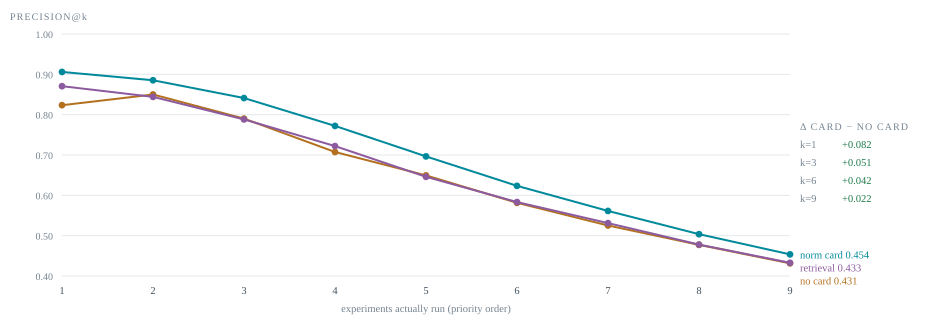
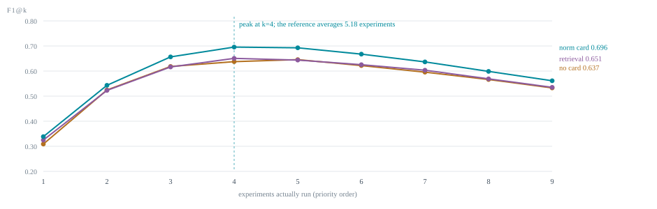
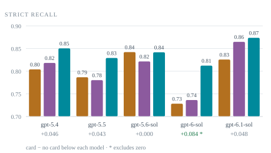
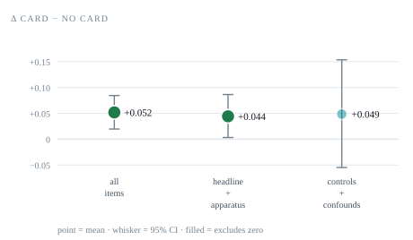

## Results

> The full interactive report, with every chart and the per-claim tables, is an artifact.
> What follows is a static copy: GitHub strips the JavaScript that draws the charts, so they
> are committed as SVGs under [`charts/`](charts) and the numbers are repeated as
> tables.

**34 claims x 5 proposer models x 3 conditions = 510 judged arms.** Each claim is scored only
against the reference experiments that decide it. The judge is `gpt-5.6-terra`, blind to which
condition it is grading, run three times per arm; each reference experiment takes the status at
least two of the three passes agree on.

### Headline

**Strict recall** — a reference experiment counts only when the judge marks it fully covered,
because a half-addressed experiment is not something a downstream system can run.

| | no card | retrieval | norm card | card − no card |
|---|---|---|---|---|
| Strict recall | 0.797 | 0.804 | **0.842** | **+0.044 [+0.018, +0.072]** |
| Recall (partial counts a half) | 0.875 | 0.879 | 0.901 | **+0.026 [+0.010, +0.043]** |
| Rank-discounted recall | 0.657 | 0.654 | 0.682 | **+0.025 [+0.003, +0.046]** |
| R-precision | 0.705 | 0.708 | 0.756 | **+0.050 [+0.016, +0.085]** |

Card − retrieval on strict recall is +0.037 [+0.012, +0.064]. Retrieval draws on the same
field papers as the card, unformatted, so the comparison that tests the thesis is card against no
card; the gap over retrieval is what the card's format adds.

### Budget

Recall climbs with the budget and precision falls, so F1 peaks where they balance — at
**k = 4** for the card and retrieval and **k = 5** unaided, against a reference averaging 5.18
experiments. The best budget to give a
proposer is about the number of experiments the question actually needs. SciFy ships at three.

Of the first R slots (R = that claim's reference size), what each slot bought:

| | hits a **new** reference item | repeats one already hit | matches nothing |
|---|---|---|---|
| no card | 67.9% | 24.7% | 7.4% |
| retrieval | 69.7% | 23.8% | 6.4% |
| **norm card** | 72.4% | 22.2% | 5.3% |

The card's gain comes from both ends: fewer early slots pile on a job already done, and fewer go
to something outside the reference altogether.

### Precision, measured two ways

Precision here is a **maximum bipartite matching**: a proposal may be spent once and a reference
item filled once, so a second proposal doing a job the first already did earns nothing. Precision
against the whole nine-slot budget is not reported — the reference averages 5.18 experiments, so
that number is capped near 0.58 whatever the proposal does and measures the budget.

A **second judge that never sees the reference** then grades every proposed experiment on its own
merits, which is the only way to ask whether work the reference lacks is nonetheless good:

| share of proposed experiments | no card | retrieval | card | card − no card |
|---|---|---|---|---|
| worth a slot | 0.919 | 0.920 | 0.918 | -0.000 [-0.023, +0.024] |
| would decide the claim | 0.821 | 0.817 | 0.788 | **-0.033 [-0.056, -0.009]** |
| tangential | 0.028 | 0.038 | 0.051 | **+0.023 [+0.009, +0.038]** |
| irrelevant | 0.000 | 0.002 | 0.000 | +0.000 [+0.000, +0.000] |
| repeats an earlier one | 0.048 | 0.034 | 0.030 | -0.017 [-0.037, -0.000] |

**All three arms are equally precise.** What shifts is the mix: the card trades claim-deciding
experiments for tangential ones, while producing fewer repeats and almost no flawed work.

Of the experiments the reference does not contain at all, **75% of the card arm's still bear
on the claim** (83% unaided), so "unmatched" is not "wasted".

### Per model, and where the gain lives

Strict recall, card − no card:

| proposer | no card | norm card | card − no card |
|---|---|---|---|
| gpt-5.4 | 0.804 | 0.850 | +0.046 [-0.009, +0.109] |
| gpt-5.5 | 0.787 | 0.829 | +0.043 [-0.015, +0.100] |
| gpt-5.6-sol | 0.842 | 0.842 | -0.000 [-0.041, +0.042] |
| gpt-6-sol | 0.728 | 0.812 | +0.084 [+0.018, +0.151] |
| gpt-6.1-sol | 0.826 | 0.874 | +0.048 [-0.021, +0.124] |

Four of five models gain; gpt-5.6-sol, the strongest unaided, is flat. Only gpt-6-sol, the weakest
unaided, clears zero on its own. Each row rests on 34 paired comparisons, so the pooled figure is
the one to quote.

On the claim's own obligations (headline, apparatus, controls, confounds) the gain is
+0.051 [+0.018, +0.085]; on controls and confounds alone it is +0.073 [-0.015, +0.164].

### What to distrust

- References are model-written and **not reviewed by a person**.
- Splitting each paper's reference by claim is a judgement call, and it is the author's.
- Re-proposing against the rewritten claims lifted both unaided arms and left the carded arm
  unmoved, halving the effect under the earlier judge prompt — clearer claims may do some of the
  card's work. Not settled: the two runs use different proposal samples.
- One judge model, three passes majority-voted (unanimous on 82% of reference items, no majority on
  5 of 2,640), and the reference-blind auditor is the same base model.
