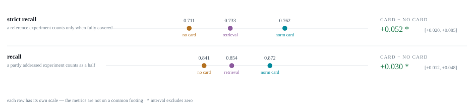
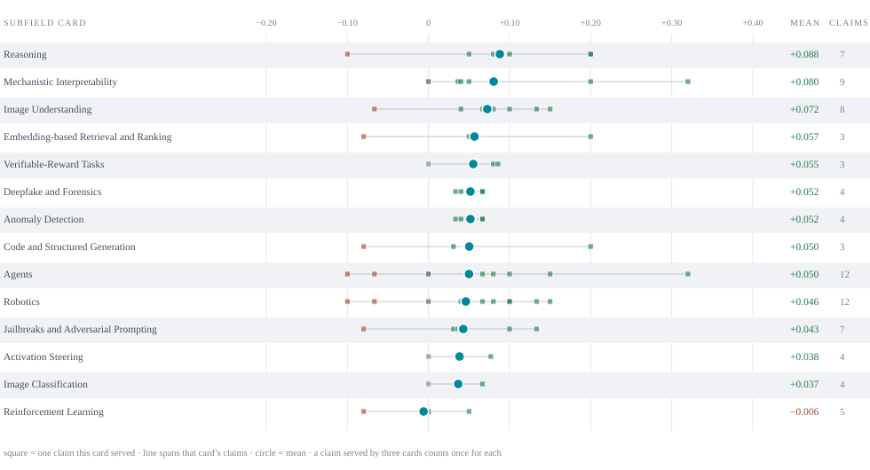

## Results

> The full interactive report, with every chart and the per-claim tables, is an artifact.
> What follows is a static copy: GitHub strips the JavaScript that draws the charts, so they
> are committed as SVGs under [`charts/`](charts) and the numbers are repeated as
> tables.

**34 claims x 5 proposer models x 3 conditions = 510 judged arms.** Each claim is scored only
against the reference experiments that decide it. The judge is `gpt-6-luna`, blind to which
condition it is grading, run three times per arm; each reference experiment takes the status at
least two of the three passes agree on.

### Headline

**Strict recall** — a reference experiment counts only when the judge marks it fully covered,
because a half-addressed experiment is not something a downstream system can run.

| | no card | retrieval | norm card | card − no card |
|---|---|---|---|---|
| Strict recall | 0.711 | 0.733 | **0.762** | **+0.052 [+0.020, +0.084]** |
| Recall (partial counts a half) | 0.841 | 0.854 | 0.872 | **+0.030 [+0.012, +0.048]** |

Recall moves about 60% as much as strict recall: what the card mostly does is turn
partly-addressed experiments into fully covered ones.

Card − retrieval on strict recall is +0.029 [−0.004, +0.063], which does not clear zero.
Retrieval draws on the same field papers as the card, unformatted, so the comparison that tests
the thesis is card against no card; the gap over retrieval is what the card's format adds.

Earlier revisions also reported recall@k, precision@k, F1@k, rank-discounted recall and
R-precision. They were dropped: the order in which a proposer lists its experiments is not what
this project measures, and the reference-blind audit below answers the precision question more
directly.

### Per model, and where the gain lives

Strict recall, card − no card:

| proposer | no card | norm card | card − no card |
|---|---|---|---|
| gpt-5.4 | 0.750 | 0.725 | −0.025 [−0.100, +0.045] |
| gpt-5.5 | 0.699 | 0.754 | +0.055 [−0.007, +0.119] |
| gpt-5.6-sol | 0.733 | 0.780 | +0.047 [−0.022, +0.121] |
| gpt-6-sol | 0.642 | 0.759 | **+0.117 [+0.045, +0.194]** |
| gpt-6.1-sol | 0.729 | 0.794 | +0.065 [−0.005, +0.135] |

Four of five models gain. Only gpt-6-sol, the weakest unaided, clears zero on its own. Below that
the ordering depends on the judge: under gpt-5.6-terra, gpt-5.4 gained +0.046 and gpt-5.6-sol
was flat. Each row rests on 34 paired comparisons, so the pooled figure is the one to quote.

On the claim's own obligations (headline, apparatus, controls, confounds) the gain is
+0.044 [+0.003, +0.086]; on controls and confounds alone it is +0.049 [−0.055, +0.154].
Confounds remain the worst-covered role, at 0.37 strict.

The card helps on 23 of 34 claims, hurts on 4 and ties on 7. Thirteen of the fourteen cards have
a positive mean effect across the claims they serve:

### Precision, from a judge that never sees the reference

A **second judge that never sees the reference** grades every proposed experiment on its own
merits, which is the only way to ask whether work the reference lacks is nonetheless good. This
audit was run by gpt-5.6-terra before the judge switch and has not been repeated.

| share of proposed experiments | no card | retrieval | card | card − no card |
|---|---|---|---|---|
| worth a slot | 0.919 | 0.920 | 0.918 | -0.000 [-0.023, +0.024] |
| would decide the claim | 0.821 | 0.817 | 0.788 | **-0.033 [-0.056, -0.009]** |
| tangential | 0.028 | 0.038 | 0.051 | **+0.023 [+0.009, +0.038]** |
| irrelevant | 0.000 | 0.002 | 0.000 | +0.000 [+0.000, +0.000] |
| repeats an earlier one | 0.048 | 0.034 | 0.030 | -0.017 [-0.037, -0.000] |

**All three arms are equally precise.** What shifts is the mix: the card trades claim-deciding
experiments for tangential ones, while producing fewer repeats and almost no flawed work.

Of the experiments the coverage judge links to no reference item, **80% of the card arm's still
bear on the claim** (85% unaided), so "unmatched" is not "wasted".

### The judge

The judge moved from `gpt-5.6-terra` to `gpt-6-luna` in this revision, for cost. Both re-judged
the same 510 proposals, three passes each:

| judge | cost, 510 arms | item agreement with terra | suite, current prompt | strict recall, no card / card | card − no card |
|---|---|---|---|---|---|
| gpt-5.6-terra | $54.26 | 87.2% (pass vs pass) | 78/84 | 0.797 / 0.841 | +0.044 [+0.017, +0.072] |
| **gpt-6-luna (adopted)** | $5.78 | 84.8% | 78/84 | 0.711 / 0.762 | **+0.052 [+0.020, +0.084]** |
| Decisions API, gpt-6-luna (not adopted) | $0.21 | 74.0% | 89.7%\* | 0.753 / 0.815 | +0.062 [+0.034, +0.091] |

\* single pass per case, target items.

gpt-6-luna disagrees with terra about little more than terra disagrees with itself. Most of the
difference runs one way (227 items terra calls covered are partial for gpt-6-luna, 54 the other
way), so it scores every condition about 0.08 lower; **absolute numbers do not compare with
earlier revisions, but the differences between conditions do.** The Decisions API, which returns
a label with no written reasoning, was rejected: it credits controls run outside the setting the
claim names, agrees least with either judge, and gives no reasons to check a verdict against.

### What to distrust

- References are model-written and **not reviewed by a person**.
- Splitting each paper's reference by claim is a judgement call, and it is the author's.
- Re-proposing against the rewritten claims lifted both unaided arms and left the carded arm
  unmoved, halving the effect under the earlier judge prompt — clearer claims may do some of the
  card's work. Not settled: the two runs use different proposal samples.
- One judge model, three passes majority-voted (unanimous on 77% of reference items, no majority
  on 8 of 2,640). The pooled effect survives a change of judge; per-model and per-claim figures
  do not.
